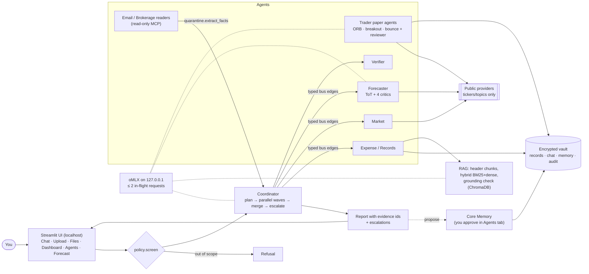
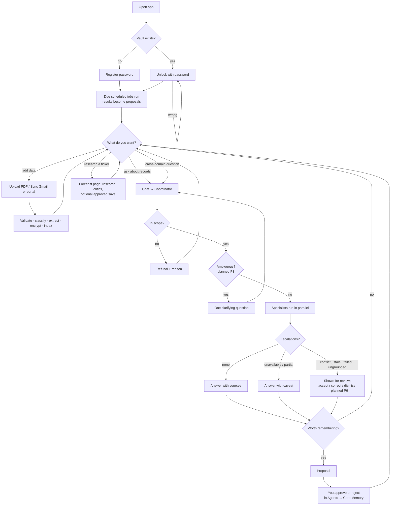

# Architecture

personal_ai is a local, privacy-first personal assistant and forecaster. Everything private (documents, chat, memory, credentials)
stays on your machine, encrypted at rest in one vault. Models run locally on **oMLX**. A **Coordinator** delegates work to specialist
agents and only hands you a result when the evidence supports it; otherwise it tells you what is missing, stale or in conflict.
It never trades, pays, runs commands or diagnoses. All evaluation data is synthetic or public.

Diagrams: below (source of truth, renders on GitHub) and the Miro board https://miro.com/app/board/uXjVEVwdVZo=/.
Next: [platform_plan.md](platform_plan.md) (rules, contracts, metrics) → [roadmap.md](roadmap.md) (what is left). Index: [README.md](README.md).

## 1. Components

| Layer | Code | Detail doc |
|---|---|---|
| UI | `src/interface/` | [platform_plan.md](platform_plan.md) §3.1 |
| Agents | `src/agents/orchestration/` (coordinator, bus, quarantine, memory, policy, verifier) | [platform_plan.md](platform_plan.md), [multi_agent_design.md](multi_agent_design.md) |
| AI engine + RAG | `src/ai_engine/` | [ai_engine.md](ai_engine.md), [rag_design.md](rag_design.md) |
| Forecaster | `src/forecaster/` | [forecaster.md](forecaster.md) |
| Trader (plan + paper agents) | `src/trader/` | [trader.md](trader.md) |
| Data + security | `src/data_vault/`, `src/security/`, `src/data_ingestion/`, `src/data_extraction/` | [security_design.md](security_design.md) |
| Evals | `evals/` (`make eval`, `make eval-rag`) | [platform_plan.md](platform_plan.md) §5 |

## 2. User flow

## 3. How a question flows

1. **Policy** refuses trading, payments, shell commands, diagnosis and secret requests before any planning.
2. A rule-based **planner** builds a typed `Plan` (bills → Expense; tickers → Forecaster per symbol; market words → Market).
3. Independent steps run **in parallel** with per-step timeouts and one retry for transient errors. Specialists return typed
   **findings** (value, evidence ids, confidence, status).
4. A deterministic **merge** reports conflicts instead of averaging them; **escalation** lists conflict, stale/unavailable data,
   failed steps and ungrounded claims; the **verifier** checks cited figures.
5. The reply is rendered with sources. Memory changes are only **proposals**; your click in *Agents → Core Memory* commits them.

Document questions use [rag_design.md](rag_design.md): exact figures come from structured records, fuzzy questions from hybrid search.

## 4. Design principles

- **Local first.** Private content goes only to local services. Public research sends tickers/topics, never personal context.
- **One key path.** The vault key exists only via `AuthManager`.
- **Untrusted by default.** Email, portal, web and news text is data, never instructions; it reaches agents only as schema-checked facts.
- **Least disclosure.** Agents exchange only the fields a task needs, over typed per-edge schemas.
- **Deterministic where it matters.** Totals, merging, escalation and number checks are code; models interpret.
- **Explicit uncertainty.** Missing, stale or conflicting evidence becomes a visible status and a question to you.
- **Human approval for persistence.** Core Memory changes and any write-capable tool need you.
- **Branch only where it pays.** Tree of Thought in the forecaster only; records, planning and RAG stay linear ([forecaster.md](forecaster.md) Part 2).

## 5. Framework mapping (plain Python, by choice)

The code imports no agent framework: one orchestration layer, all inference on the loopback client, invariants in tested code.

| Concept | Framework equivalent | Here |
|---|---|---|
| Plan steps + `depends_on` | LangGraph nodes and edges | `schemas.Plan`, `Coordinator.run` waves |
| Specialist roles with one goal | CrewAI agents / crew | `templates.py` roles, `workers.py`, ToT critics (`scenarios.py`) |
| Branch / parallel control flow | LangChain LCEL `RunnableBranch` / `RunnableParallel` | `tot.search` beam loop, thread-pool waves |
| Tools and shared state | MCP tools / resources | read-only MCP (`ingest.ReadOnlyMcp`); ThoughtTree is MCP-exposable (not built) |

## 6. What changed from the original plan

| Original idea | What exists |
|---|---|
| Ollama + LlamaIndex | oMLX (Ollama kept but disabled), hand-rolled Advanced RAG on ChromaDB |
| SQLCipher | Application-level AES-256-GCM over SQLite |
| Biometric login | Password-derived key |
| Single assistant | Coordinator + specialists, MCP tools, skills, approval-gated Core Memory |
| stock_predictor as a service | Absorbed as pure services in `src/forecaster/` |
| Daily digest sent to a messaging app | Dropped (would be a write); digest shown in-app |
| Not planned | Forecaster ToT, eval harness, quarantine, scoped bus, bill ingestion pipeline |

## 7. Known limits

The ChromaDB index is plaintext if persisted (in-memory today, see [security_design.md](security_design.md)). Forecasts are uncalibrated
heuristics. There is no password recovery. Nothing is verified on a live oMLX server yet ([roadmap.md](roadmap.md) P9, P10).
