# Roadmap: what is built, what is left, and how to build it

**Audience: a coding agent (or human) with no prior context.** This is the only place remaining work is planned.
Rules and invariants: [platform_plan.md](platform_plan.md) §0-§2 and `AGENTS.md`. Every card below is self-contained:
do them in order, one card per branch/PR, and a card is done only when its **Accept** commands pass.

Course commitments come from the weekly checkpoints and instructor feedback (Weeks 1-6, kept outside the repo in `.idea/`).
Each card names the feedback it answers (`W5` = Week 5 feedback).

## 00. Start here (handoff for the next session, updated 2026-11-22)

**State.** Everything in §1 marked DONE is built and tested offline. Since the last handoff (PRs #36-#46): per-agent tool
scopes (S26) and every agent listed in Chat (#36); Gmail OAuth fixes for the MCP SDK (#37-#41, #44: issuer slash, own OAuth
client, read-only scope pin, stored expiry + token endpoint, path-aware metadata lookup, no refresh retry storm);
**read-only Gmail via the standard Gmail API** because Google's hosted Gmail MCP needs a Workspace Developer Preview project
that personal accounts cannot join (#42, `data_ingestion/gmail_api.py`); chat question saved before the agent runs, Email
Digest step budget (#43); agent model drives extraction (small 4B model), sync progress, Activity log for syncs and agent
turns (#45); bills dated by email when no period is stated, *Re-read*, Email Digest as a table (#46). Then (#47-#54):
S1 sync outcome list (#48), Email Digest follows the question (#49), Track O observability + S0 notices + Track M plan
(#50), Activity table/port fixes (#51), dashboard stats (#52), Sync/Forecast coverage + log levels + trace tables (#53),
readable traces + LLM-call details + injection rules + runs per type + Email Digest scope check (#54). `make test` 965
pass, `make eval` Overall PASS. Two laptops: this one has no models; the app runs with real data and oMLX on the other, where the
user tests and pastes results back.

**What exists now (where to look).**

| Area | Entry point | Code / doc |
|---|---|---|
| Gmail connection (Gmail API, read-only, own OAuth client) | Upload → Sync → *Gmail connection* | `data_ingestion/gmail_api.py`, `security_design.md` |
| Gmail bills from email text, *Sync* / *Re-read* per sender | Upload → Sync → *Bills from Gmail* | `gmail_bills.py`, `rag_design.md` R11 |
| Expected bills (overdue ledger) | Upload → Sync → *Expected bills* | `pipeline.expectations/overdue` (R7) |
| Email Digest chat agent (table answer) | Chat → *System · Email Digest* | `ingest.gmail_fetcher`, `workers.render_email_digest` |
| Activity log (tool calls, syncs, agent turns) | Agents → Activity | `store.log_activity` |
| Observability: traces, metrics, logs, 4 dashboards (local Grafana) | `OBS_OTLP_PORT=14318 OBS_GRAFANA_PORT=3001 make obs-up run-obs` | `observability.md`, `src/observability/otel.py` |
| Per-agent tool picker (deny by default), MCP *Test read access* | Agents → Edit / MCP Servers | S26, `mcp.McpManager.probe` |
| Forecast research + critics + ToT; Trader plan + paper agents; Robinhood | Forecast page | `forecaster.md`, `trader.md`, Track R |

**Live status (user, 2026-11-22, after PRs #48 S1 and #49 digest scope).** Gmail via the Gmail API (read-only). Sync on
Enbridge: 6 threads in 13 months from `enbridgegas.com`, 6 bills saved (Nov, Sep, Aug, Jul, Jun, Apr; May and Oct absent from
that domain), 0 not a bill, 6 model calls, 7 s. Email Digest now answers the question asked ("electricity and gas bills this
month" → 2 bills since the 1st, 1.7 s). Open problems, all in **Track S**:
1. **Email-text bills are saved as `.txt` documents** (Files, Dashboard, RAG). User decision: only the **official bill PDF** is a
   document; email text is a signal (bill arrived, emailed amount/due) and must not enter Files or RAG (S0).
2. **Digest and Sync disagree on the same email** (digest showed the Enbridge bill without an amount; Sync extracted one): the
   digest uses `EmailFacts` with a 2,500-char cut, Sync uses `BillEmailFacts` on the full body (S7).
3. Official PDFs are on the provider portals (emails link to them); portal recipes (R10) are not recorded yet, so no PDF
   arrives (S4 for PDF attachments, R10 for link-only emails).
4. Two forms for one provider concept (S2); what Sync covers is unclear (S3 copy); Sync is manual only (S5 schedule).

**Track O live (user, 2026-11-22, #51-#54):** stack runs on the model laptop (ports 14318/3001: a local Jaeger holds
4318 and a native Grafana holds 3000 there). User testing found: only chat visible, logs unreadable, trace links broken,
no LLM details, runs counted chat only, unexplained injection flags; all fixed and verified on a local otel-lgtm (#53,
#54). User to re-check after #54 (steps in `observability.md`). Email Digest now answers off-topic asks with its scope.
**S0 done (#50):** Gmail Sync stores manifest-only bill notices (emailed total/due), no `.txt` documents; old
`gmail_bill_*` documents migrate out of Files/RAG when Upload → Sync opens.
**Next card for the agent: M1 (Track M, central Core Memory profile), then M2 → M5, S7, S3 → S6** (S2 "one Bill providers
list" is absorbed by M4: the profile's `providers` section is that list). Template: `docs/core_memory_template.md`.

**Waiting on the user (model laptop).**
1. Merge open PRs, `git pull`, `PERSONAL_AI_MCP_OAUTH_CALLBACK_PORT=8765 make run` (a Web-type OAuth client needs that port).
2. Upload → Sync → each Gmail sender → *Re-read*; paste the status line (it has thread/message/not-a-bill/model-call counts).
3. Still open from before: Robinhood earnings calendar, Portfolio chat, Trader paper-agent backtest, AI review critics
   (see `state_report.md`); P9/P10 live runs; P11 final numbers. T9 broker orders needs user sign-off.

**Opencode prompt for the model laptop** (the user pastes it after each testing session; output is pasted back here, never
committed): run `make state-report` per `docs/state_report.md`; ask the user once for the user-testing rows, live timings,
UI document counts, errors (type + file:line); fill only the placeholders; print one markdown block.

**How work is done here.** One branch + PR per card unless the user asks to batch; stack on an open PR only when it touches
the same code, and say so in the PR body. If a PR conflicts, merge `main` into the branch (force-push is blocked by a local
hook; never rebase a pushed branch). After each card: update §0 diagram, §1 status, the Miro frames named in §0,
`CHANGELOG.md`, and `security_design.md` when security behaviour changed. GitHub ops: `GH_TOKEN="$(gh auth token --user
Sandyzie05)" gh ...` (the active `gh` account is a different one). The repo is **public**: no personal paths, names, amounts,
sender addresses or vault data in docs, tests or fixtures.

## 0. Where we are (progress journey)

Updated after every card (also mirrored on the Miro board, frame "Progress journey"). Green = done, amber = in progress, grey = planned, blue = needs a live run by the user.

```mermaid
flowchart LR
  W1[W1 proposal + assessment] --> W2[W2 reasoning, memory, tools] --> W3[W3 RAG R0-R6] --> W4[W4 ToT forecaster] --> W5[W5 multi-agent] --> W6[W6 safety plan] --> D[Docs + roadmap<br/>2026-11-20]
  D --> FX[Fixes: Yahoo UA, .env keys, NumPy 2, state report] --> F[Track F: Forecast overhaul on configurable agents F1-F10] --> FL[F1 live check + F7 news analyst] --> P1[P1 stress set] --> P2[P2 verifier relevance] --> P3[P3 clarify] --> P12[P12 missing statements] --> P5[P5 memory recall] --> P4[P4 composed leakage] --> P6[P6 escalation metrics] --> P7[P7 stability] --> P8[P8 held-out ToT]
  P8 --> R[Track R: Robinhood research R0-R10 + Portfolio chat] --> P9[P9 live run] & P10[P10 RAG calibration] & RL[Robinhood live check] --> P11[P11 final submission]
  R --> RP[R9 Portfolio chat + R10 schema fit] --> GB[R11 Gmail bill text, PR 34] --> LC[Live checks: Gmail, calendar, Portfolio chat, paper agents] --> P11
  GB --> GX[Gmail fixes + Gmail API read-only, PRs 36-46] --> S1[S1 why bills are missed, PR 48] --> DQ[Digest question scope, PR 49] --> S0[S0 email text = signal, not a document] --> S7[S7 digest and Sync agree] --> S2[S2 one Bill providers list] --> S3[S3 Upload page IA] --> S4[S4 bill PDFs from Gmail into RAG] --> S5[S5 sync window + schedule] --> S6[S6 run observability]
  S0 --> M1[M1 Core profile schema] --> M2[M2 human-only editor + template import] --> M3[M3 scoped read path] --> M4[M4 provider resolution + preferences] --> M5[M5 profile disclosure evals]
  S0 --> O1[O1 OTel core] --> O2[O2 traces end to end] --> O3[O3 metrics + logs] --> O4[O4 local LGTM stack + dashboards] --> O5[O5 telemetry leakage eval] --> OF[O fixes from user testing, PRs 51-54] --> OL[Live re-check after 54]
  R --> T0[T0 trader docs] --> T1[T1 engines] --> T2[T2 agents] --> T3[T3 UI] --> T4[T4 evals] --> T5[T5 AI paper agents + scoreboard] --> T9[T9 broker orders later]
  classDef done fill:#2e7d32,color:#fff,stroke:#1b5e20
  classDef now fill:#f9a825,color:#000,stroke:#f57f17
  classDef todo fill:#eeeeee,color:#333,stroke:#9e9e9e
  classDef user fill:#1565c0,color:#fff,stroke:#0d47a1
  class W1,W2,W3,W4,W5,W6 done
  class D,FX,F,FL done
  class P1,P2,P3,P12,P5,P4,P6,P7,P8,R done
  class P11 now
  class T0,T1,T2,T3,T4,T5,RP,GB done
  class LC user
  class T9 todo
  class GX done
  class S1,DQ done
  class S0 done
  class O1,O2,O3,O4,O5,OF done
  class OL user
  class M1 now
  class M2,M3,M4,M5 todo
  class S7,S2,S3,S4,S5,S6 todo
  class P9,P10,RL user
```

**Rule for whoever finishes a card:** in the same change, move it to `done` (and the next card to `now`) here, update §1,
and update the Miro board https://miro.com/app/board/uXjVEVwdVZo=/ : frame "0 Progress journey" (Mermaid diagram widget
`3458764691150425568`: change the node's class `todo` → `done`/`now` and the "Last update" text) and frame "6 Roadmap"
(recolour the card shape green `#B3E65F`). Frames 1-4 hold the system flow, phases, success criteria and RAG; frame 5 the user flow.

## 1. Capability status (implemented vs planned)

Status: **DONE** = code + tests + eval row · **PARTIAL** · **PLANNED** (card below) · **USER** = needs a live run on the user's laptop.

| Capability | Status | Evidence / card |
|---|---|---|
| Encrypted vault, single key path, localhost-only UI | DONE | `security_design.md`, `test_auth.py`, `test_vault_lock.py` |
| Upload → classify → extract → structured records (category-driven) | DONE | `data_extraction/categories.py`, `test_extractor.py` |
| Advanced RAG: header chunks, period filter, hybrid BM25+dense, dedupe, abstention, grounding check | DONE offline | `rag_design.md`, `make eval-rag` (recall@5 1.0) |
| RAG thresholds (`min_relevance`, `k`) tuned on the real embedder | USER | P10 |
| Coordinator: typed plan, parallel waves, bounded retry, deterministic merge, escalation | DONE | `coordinator.py`, `make eval` (63/63 faults, 26/26 conflicts) |
| Policy refusals (trade, pay, shell, diagnose, secrets) | DONE | `policy.py`, eval 24/24, 0/12 false refusals |
| Quarantine for untrusted email/portal/news text | DONE | `quarantine.py`, eval 0/38 reaching summaries |
| Per-agent tool scope (tick each MCP tool, deny by default; built-ins read-only); every agent visible in Chat | DONE | S26, `TestToolAllowlist`, `test_agents_page_smoke.py` |
| Per-edge bus schemas + PII/canary scan | DONE per edge | `bus.py`, eval 0 leaks / 190 msgs |
| Leakage across multiple hops and through shared memory | DONE | P4: eval 0 canaries outside sinks (114 runs, 969 sinks, 102 hops); dependency inputs default-deny |
| Core Memory: propose → UI-token approval → supersede | DONE | `memory.py`, eval 0/114 unauthorized |
| Core Memory **read path** (approved facts used in later answers) | DONE | P5: recall 9/9, superseded/forgotten returned 0; Forget button |
| Verifier: figure appears in cited evidence | DONE | `verifier.py` |
| Verifier: cited record matches claim category/period/account | DONE | P2: wrong-record citations caught 7/7 |
| Ambiguity → one clarifying question | DONE | P3: templated period/account/ticker question; 0 false asks on golden |
| Missing statement observed → told + offered a sync (observation drives the next step) | DONE | P12: 3/3 reported, never invented; Sync now on click |
| Single-source / partial answers carry a caveat | DONE (bills: corrected periods only) | P2 `single_source` |
| Planner picks the expected specialists (tool-selection metric) | DONE | P1: 76/76 (golden + stress) |
| Scheduled runs (e.g. a daily brief query) | DONE | Agents → Scheduled; `schedule.py` |
| Labelled stress set with expected action | DONE | P1: 56/56 coordinated, B1 34/56 |
| Escalation precision/recall + reviewer decision log | DONE | P6: precision 100%, recall 100%; Accept/Correct/Dismiss logged (ids only) |
| Repeat-run / perturbed-condition stability | DONE | P7: `make eval-stability RUNS=10`, every hard row 10/10 |
| Forecaster: research, 4 parallel critic agents, ToT verdict, explainer, outcome tracking | DONE (F1 live 3/4 critics, 2026-11-21) | F1 |
| Built-in agents tweakable in the Agents tab; every AI step has an assigned agent + chip | DONE | F2, F3 (`test_agent_overrides.py`, `test_agents_page_smoke.py`) |
| Chat selector lists every agent in the system | DONE | F10 |
| LLM news analyst behind quarantine (Events) | DONE offline; live = one click (USER) | F7, eval "News analyst" 0/190 |
| Tree-of-Thought thesis search (beam 3, depth 2, ≤ 9 nodes) | DONE offline | `forecaster.md` Part 2, eval 8/8 |
| ToT held-out evaluation + calibration (Brier) | DONE (Brier win needs dev calibration) | P8: held-out acc 0.76 vs 0.59/0.70; Brier 0.414 vs 0.488/0.430 (raw: vote better) |
| Gmail / brokerage read-only workers | DONE vs fakes | eval 7/7; no real MCP run |
| Bill ingestion: validation, manifest, ledger, Gmail attachments, portal recipe runner | DONE vs fixtures | `rag_design.md` R7-R9 |
| Gmail bill sync from email text (utilities that email the total, not a PDF) + Expected bills list/remove | DONE; live: works via Gmail API (#48 fixed no-amount notices); stores email text as documents → S0 | `rag_design.md` R11, eval row 0 in 4; gaps → Track S |
| End-to-end observability: OpenTelemetry traces, metrics, logs; local Grafana LGTM; 4 dashboards; telemetry leakage eval | DONE; live on the model laptop (#50-#54: readable span tree, LLM-call details, injection rules, runs per type, panel descriptions); final re-check: USER | Track O, `observability.md` |
| Email Digest scope check (off-topic asks answered with the agent's scope, no mail read) | DONE 2026-11-22 (#54) | `service._run_query`, `test_otel.py` |
| Bill sync clarity, one provider list, bill PDFs from Gmail into RAG, sync window/schedule, run observability | S1 DONE (#48), digest scope DONE (#49), S0 DONE (#50: email text = notice, not a document); S7, S3-S6 PLANNED; S2 → M4 | Track S |
| Central Core Memory profile (human-only edits, scoped per agent, provider resolution) | PLANNED | Track M, `core_memory_template.md` |
| Real provider portal recipes | USER | R10 in `rag_design.md` |
| Live oMLX end-to-end (chat, RAG, Coordinator, ToT, `make eval-live`) | USER | P9 |
| Robinhood research data (fundamentals, earnings, options IV, filings) + private Portfolio fit + Portfolio chat agent | DONE vs fixtures; live = USER | Track R: broker text 0/5, account canaries 0 in 19 sinks, valuation golden 3/3, portfolio chat 0/5 (S25) |
| Trader: intraday day-trade research and plan (scan, entry, stop/target, Monte Carlo odds, sizing, risk label); advice only, no orders | DONE vs fixtures; live = USER | Track T: shape 0/13, MC 4/4, risk golden 5/5; T5 paper agents: hostile 0/90, lookahead 0/68, ledger 7/7; T9 broker orders PLANNED |
| Daily Gmail digest *sent* to a messaging app (W2 idea) | DROPPED | sending is a write; read-only invariant S6. Digest is shown in-app |
| Voice, cross-device sync, key rotation/backup, file watcher | OUT OF SCOPE (capstone) | `security_design.md` |

All evaluation data is synthetic or public. No real-market skill is claimed.

### 1.0 Assignment topic coverage (2026-11-22)

| Week topic | Built and used in the app | Evidence | Open |
|---|---|---|---|
| W1 agentic need, environment, actions | Local assistant over vault records, Gmail, portals, market data; read-only actions, refusals | `policy.screen`, `make eval` refusal rows | – |
| W2 reasoning loop, memory, tools | Hierarchical ReAct (coordinator → specialists), working state, RAG, approval-gated Core Memory + recall, MCP read-only tools | P5 recall 9/9, 76/76 tool picks | – |
| W3 retrieval (RAG) | Advanced RAG in retriever: chunk headers, month filter, hybrid search, grounding check, one re-retrieve | `make eval-rag` (offline embedder) | P10 real-embedder tuning; S0 keeps email text out of RAG |
| W4 Tree of Thought | Beam ToT in forecaster only, closed thoughts + evidence ids, code then specialist critics | held-out Brier beats linear/vote (P8) | P9 live run |
| W5 multi-agent | Parallel specialists, per-edge strict bus schemas, verifier, dependency inputs | overlap yes, latency 0.41× B2, cross-domain 100% | – |
| W6 guardrails | Static: `policy.screen` refusals, read-only Gmail/broker, `extra="forbid"` bus schemas, approval-only Core Memory. Input: tool-less quarantine extractor. Runtime: step timeouts, 1 retry, deadline, staleness, ToT 9-node cap. Output: evidence or explicit status; verifier relevance | refusals 24/24 (0/12 false), injection 0/38, grounded 126/126, relevance 7/7 | – |
| W6 logging | Encrypted Activity log (no plaintext log files, by design): every bus message incl. rejections, MCP tool calls, agent turns (steps, status, ms, model), RAG turns (evidence ids, scores, grounded), syncs, scheduled runs, slot runs, injection flags, reviewer accept/correct/dismiss | `store.log_activity`, `log_review`, `slots.log_run` | done in O3: chat refusals + escalation kinds logged |
| W6 observability | OpenTelemetry traces/metrics/logs → local Grafana LGTM, 4 dashboards (Track O, `observability.md`); Agents → Activity table; per-run step status + timing in `RunReport`; eval reports `evals/results/` | P6 escalation P/R 100%, P7 10×8 stable | live check (USER); in-app summary/filter/running-now (S6) |
| W6 human intervention | Risk-tiered routing (proceed / caveat / ask / escalate), one-question clarify, reviewer accept/correct/dismiss, overrides → test cases | escalation P/R 100% | – |
| Final | Implemented-vs-planned table, framework mapping, synthetic-data statement | §1, `architecture.md` §5 | P9/P10 live numbers, P11 packaging |

### 1.1 Weekly commitment audit (2026-11-20)

Each commitment made in a weekly checkpoint or raised in feedback, checked against the code.

| Week | Commitment | Status | Card |
|---|---|---|---|
| W1 assessment | Allowlisted, schema-validated tools; ≥ 18/20 labelled tasks pick the right tool sequence | DONE: 76/76 planner picks (golden + stress) | P1 |
| W1 assessment | ≤ 5 orchestration steps, 1 retry, ≥ 9/10 recoverable faults complete, unrecoverable abstain | DONE (63/63) | – |
| W1 assessment | Approved task memory retrieved later (≥ 9/10), corrections supersede, forgotten never retrieved | DONE: recall 9/9, superseded/forgotten 0 | P5 |
| W1 assessment | ≤ 3 alternative scenarios with a rubric; contradictory evidence changes the selection | DONE (ToT) | – |
| W1 assessment | Parallel specialists with overlapping timestamps; failed specialists visible | DONE | – |
| W1 assessment | Adversarial tests: injection, invalid args, locked vault, unapproved writes, exfiltration | DONE | – |
| W1 assessment | Forecast eval: chronological split, directional accuracy, calibration, coverage, abstention, benchmark | DONE: held-out Brier + accuracy (P8); realized outcomes still need elapsed horizons | P8 |
| W1 | Check which statements exist before summarizing; never invent missing amounts | DONE: missing statements reported, never invented (3/3) | P12 |
| W2 | Observation drives replanning: a missing statement triggers a fetch or a confirmation | DONE: ledger drives a missing_statement escalation + Sync now (click) | P12 |
| W2 | Expense → Market shares only the cash-flow delta | DONE (bus edge) | – |
| W2 | Daily Gmail digest sent to a messaging platform | DROPPED (write action); in-app digest + scheduled query | – |
| W2 | Approval-gated Core Memory | DONE | – |
| W3 | Chunking fix, headers, month filter, keyword search, answer check, test set first | DONE offline | – |
| W3 | Set the similarity cutoff from data, not a guess | Not tuned on real embedder | P10 |
| W3 | Show both documents when two disagree | DONE (conflict escalation) | – |
| W4 | ToT live run (converged + depth-2 case) | Not run | P9 |
| W4 feedback | Thresholds tested only on 8 self-labelled cases | DONE: 200-case planted generator, dev/held-out split | P8 |
| W4 feedback | CrewAI/LangChain/MCP mapping unclear | DONE (`architecture.md` §5) | – |
| W4 | ThoughtTree as a read-only MCP resource | Not built (optional) | §6 |
| W5 feedback | Explain how the 100% is measured | DONE (`platform_plan.md` §5) | – |
| W5 feedback | Ambiguous / incomplete / stale / conflicting stress tests | DONE: 56 labelled cases, 100% | P1, P3 |
| W5 feedback | Verifier must check accuracy and relevance | DONE: 7/7 wrong-record caught | P2 |
| W5 feedback | Forecast quality vs single-agent baseline | DONE: ToT vs linear/vote held-out; stress B1 34/56 | P8, P1 |
| W6 | Evidence relevance ≥ 95%, escalation precision/recall ≥ 90%, Brier on held-out | DONE: 100% / 100% / 100%; Brier beats both after dev calibration | P2, P6, P8 |
| W6 | Single-source answers proceed with a caveat | DONE | P2 |
| W6 | Reviewer accept / correct / dismiss, logged; overrides become test cases | DONE (stubs for human labelling) | P6 |
| W6 feedback | Safety results consistent across repeated tests and changing conditions | DONE: 10 runs × 8 perturbations | P7 |
| W6 feedback | No unintended flow between agents or into shared memory | DONE: 0 (incl. a real leak fixed: dependency inputs) | P4, S18 |

## 2. Order

**Next (2026-11-22): Track S, S0 → S7 → S2 → S6** (bills sync clarity and PDF ingestion; user-reported). Then the items below.

All agent-doable cards are done (2026-11-21, PRs #30-#35). **Remaining, in order:** P9 live run and P10 RAG calibration (USER),
Robinhood live check (USER: add the server, confirm argument names; 2026-11-21 fix: payload cap + all-accounts holdings, re-verify live),
Trader live check (USER: paper-agent backtest with the local model, invalid-reply rate; Track T), then P11 final numbers. Track T
(PRs #31-#32) is done offline; T9 broker orders stays planned and needs user sign-off.

## 3. Conventions for every card

- Branch from `main`; never commit to `main`. Commit/push only when the user asks.
- Synthetic data only. No real names, accounts or amounts in fixtures.
- New behaviour = unit test in `tests/` + an eval row in `evals/run.py::evaluate` (`hard=True` unless the card says info).
- Never loosen an existing gate, schema or threshold to make a case pass. If a new case fails, fix the code or record it as a finding.
- Update the §0 progress diagram and the Miro "Progress journey" frame.
- Finish with: `make test` green, `make eval` → `Overall: PASS`, then update §1 above, `platform_plan.md` §5 (metrics) and
  the `security_design.md` changelog when security behaviour changed, and add a `CHANGELOG.md` entry.

## 4. Cards

### Track F. Forecast overhaul on configurable agents (do first)

**Problem (model-laptop test, 2026-11-21).** Research output is a wall of raw numbers and JSON; specialist review failed
(2 `invalid`, 2 `timeout`, 0 coverage) with no reason shown; Recommendations, Drilldown, System and Screens crashed (NumPy 1.26 vs
pyarrow, fixed in PR #23); Events broken; Validation unexplained. Built-in agents are code constants (`store.update_agent` is a
no-op for them) and the forecast specialists do not use the Agents system at all (prompts hardcoded in `forecaster/scenarios.py`).

**Target design (user decisions).**
- Every AI step is a **workflow slot** with a **fixed default agent**. The user **tweaks that agent in the Agents tab** (model,
  temperature, max tokens, extra instructions, skills, MCP servers/tools within the slot's allowlist) and can **reset to default**.
- Locked by the slot in code, never editable: tool allowlist, output schema, time/token/call budget, the shared safety rules
  (`templates._COMMON`), untrusted-input rules (S1, S16). Prompts are defence in depth; schemas and budgets are the control.
- Every feature that runs an agent shows a chip: **"Agent: <name> · <model> · Tweak in Agents"**, plus per-run status and time.
- The Chat agent selector lists **every agent in the system** (General, all built-ins that are chat-capable, all custom agents).

Slots in scope (Forecast first; other pages later):

| Slot | Default agent | Tools | Output |
|---|---|---|---|
| `forecast.critic.macro` / `.valuation` / `.event` / `.downside` | `builtin-critic-<role>` | none | `SpecialistOpinion` (evidence ids from the snapshot) |
| `forecast.thesis_explainer` | `builtin-thesis-explainer` | none | `ThesisExplanation` (closed fields + ≤ 3 sentences citing evidence ids) |
| `forecast.news_analyst` | `builtin-news-analyst` | none; input = quarantined headline facts only | closed-enum sentiment counts per topic |
| `forecast.watchlist_explainer` | `builtin-watchlist-explainer` | none | per-symbol closed reason codes + ≤ 2 sentences |

#### F1. Specialist reliability on one laptop — DONE 2026-11-21 (live: ADBE 3/4 critics on the 4B)

- **Now:** `scenarios.ScenarioSwarmService` runs 4 calls under one 60 s deadline (`FORECAST_SCENARIO_DEADLINE_SECONDS`) while
  `PERSONAL_AI_INFERENCE_CONCURRENCY=2`, so 2 calls queue and time out on a 27B model. `max_tokens` is capped at 400
  (`FORECAST_MODEL_MAX_TOKENS`); any non-JSON, truncated or wrongly cited answer becomes `invalid` with no reason.
- **Build:**
  1. Record a closed `invalid_reason` per specialist: `not_json | truncated | schema | unknown_evidence | source_mismatch |
     empty` (no model text). Show it in the UI and the activity log.
  2. Strip a leading `<think>…</think>` block before JSON parsing; request JSON via the existing `format=` schema.
  3. Queue-aware budget: per-call deadline = remaining run budget, and the run deadline =
     `ceil(4 / concurrency) × FORECAST_SPECIALIST_CALL_SECONDS` (new config, default 45). Default the critics to
     `PERSONAL_AI_OMLX_WORKER_MODEL` when set. Raise `FORECAST_MODEL_MAX_TOKENS` to 700 for critics.
  4. `make state-report` adds: last run's specialist statuses + reasons + latency (counts/enums only). *As built:* the script
     cannot unlock the vault, so the user copies the AI review table's status/reason/seconds into the report's `<LIVE>` section.
- **Accept:** unit tests per `invalid_reason`; fake-client test with concurrency 2 and 4 critics completes in budget;
  live (user): ≥ 3/4 critics `completed` on AAPL, recorded in the next state report.

#### F2. Editable built-in agents (overrides + reset) — DONE

- **Build:** vault key `agent_overrides` (`{agent_id: {field: value}}`), added to `INTERNAL_VAULT_KEYS` (S13). `store.get_agent`
  merges template + override; `store.update_agent` on a `builtin-*` id writes only allowlisted fields
  (`model, temperature, max_tokens, extra_instructions, skills, mcp_servers, enabled_tools`); `store.reset_agent(id)` deletes the
  override. Instructions sent = slot rules + template rules + `extra_instructions` + `_COMMON` (order fixed; `_COMMON` last).
  Agents tab: built-ins get an Edit form (same form as custom agents, locked fields shown read-only) and "Reset to default".
- **Accept:** tests: override persists across restart; locked fields ignored; reset restores template; `_COMMON` always present;
  AppTest edits a built-in and resets it. `make eval` unchanged.

#### F3. Workflow slot registry + agent chip — DONE

- **Build:** `src/agents/slots.py`: `SLOTS = {slot_id: Slot(default_agent, allowed_tools, output_schema, budget, chat_capable)}`;
  `agent_for(vault, slot_id)` returns the (merged) default agent; tools outside `allowed_tools` are dropped at call time, not just
  hidden. `interface/components.py::agent_chip(slot_id)` renders name, model, status, "Tweak in Agents" link (sets the Agents tab
  selection). Activity log entries gain `slot_id`, `agent_id`, `latency_ms`, `status` (no content).
- **Accept:** tests: slot tool allowlist enforced even if the agent lists more tools; chip renders in AppTest.

#### F4. Dedicated critic agents wired to slots — DONE (Forecast page and Coordinator)

- **Build:** add `builtin-critic-{macro,valuation,event,downside}` to `templates._ROLES` with role prompts moved from
  `scenarios.PROMPTS` (single source), skills `skills/critic-<role>.md` (what evidence counts, when to say uncertain, citation
  rules), no tools. `ScenarioSwarmService` takes `agent_for(vault, "forecast.critic.<role>")` per role: model, temperature,
  max_tokens, instructions. ToT (`tot.py`) is unchanged; it still calls the swarm once at depth 2.
- **Accept:** tests: tweaking the macro critic's temperature/model reaches its client; prompts come from templates only
  (grep test: no role prompt left in `scenarios.py`); `make eval` ToT rows unchanged.

#### F5. Research section redesign (one flow) — DONE

- **Flow:** ticker + horizon → **Evidence** (price chart with SMA 20/50 and Bollinger, plotly; indicator cards; provider chips with
  status; "missing inputs" list) → **AI review** (one row per critic: agent chip, status, reason, latency, stance + confidence,
  cited evidence ids clickable to the evidence card) → **Verdict card** (ToT selected scenario, margin, runner-up, why in the
  explainer's ≤ 3 sentences, "what would change this", uncertainty flags) → **Track** (save forecast; session-sequence input
  moved into an "Advanced: outcome tracking" expander with a plain explanation).
- Raw JSON (provenance, scenario report) only in a "Details" expander. Empty, loading and error states for every block.
- **Accept:** AppTest with fake providers + fake critics: each block renders; failure of any provider or critic shows a reason, not a
  traceback; no `st.json` outside "Details".

#### F6. Watchlist (was Recommendations) — DONE

- Table with lean, confidence, risk, a sparkline per symbol, closed reason codes; `forecast.watchlist_explainer` adds ≤ 2 sentences
  per symbol citing evidence ids. "Research" button per row opens F5 for that ticker.
- **Accept:** AppTest renders 3 symbols; explainer failure degrades to reason codes only.

#### F7. Events: LLM news analyst behind quarantine — DONE offline 2026-11-21 (step 5, counts into ToT, still optional)

- **Why:** every AI step should have an agent (user, 2026-11-21); news is the one Forecast step without one. Headlines are
  untrusted (S1, S16), so the agent may only see quarantine output.
- **Now:** `forecaster/news.py::NewsService` scores sentiment by keyword (`Story.sentiment`, `directional_bias`,
  `impact_score`); `forecast_tabs.render_events` shows stories via `st.text`. `orchestration/quarantine.extract_facts(raw, source,
  schema, client)` returns `Extraction(facts, flagged, error, trust="untrusted")`, rejects instruction-like output and blanks
  `topic` on flagged input. Pattern to copy: `schemas.EmailFacts` (closed enums, no free text).
- **Build:**
  1. `schemas.NewsFacts(Strict)`: `ticker` (ticker pattern or ""), `topic: Literal[earnings, guidance, product, legal,
     regulation, macro, management, deal, other]`, `sentiment: Literal[positive, neutral, negative]`, `materiality:
     Literal[low, medium, high]`. No free-text field.
  2. Slot `forecast.news_analyst` → `builtin-news-analyst` (templates role, skill `untrusted-content-handling`, no tools,
     temperature 0). The slot's "agent" call **is** `extract_facts` with the agent's model/temperature; its instructions are
     appended after quarantine's fixed `SYSTEM` (never replace it).
  3. `forecaster/news_analyst.py::analyze(stories, client, agent, limit=10)`: one `extract_facts` per headline
     (`title + " — " + publisher`), bounded by `FORECAST_SPECIALIST_CALL_SECONDS` total; returns per-ticker counts
     `{ticker: {positive, neutral, negative, high_materiality}}` plus `flagged` count. Nothing else leaves the function.
  4. Events UI: agent chip + *Analyze with AI* button; show the counts table next to the keyword leanings and say where they
     disagree. Headlines stay `st.text`.
  5. Optional, after review: feed counts into ToT as the `news` driver (`tot.FAMILY["news"]`), counts only.
- **Files:** `schemas.py`, `templates.py`, `slots.py`, new `forecaster/news_analyst.py`, `forecast_tabs.py`, tests.
- **Accept:** unit tests (hostile headline → facts None or topic blank; counts only); `evals/injection.py` run through
  `news_analyst.analyze` adds a row "News analyst: injected text reaching output" = 0 (hard); AppTest renders the counts and the
  hostile headline inert; `make eval` PASS.
- **Don't:** add a free-text field to `NewsFacts`, pass headlines to the critics, or render any model output with markdown.

#### F8. Screens and Technical drilldown — DONE (line chart + SMA; candlestick not added)

- Screens: sortable table + mini-charts, "Research" per row. Drilldown: candlestick + indicators chart, indicator table with plain
  explanations, unavailable inputs listed with why.
- **Accept:** AppTest for both with fake market data.

#### F9. Track record (was Validation) + System health — DONE

- Explain what is measured (directional accuracy, coverage, abstention, benchmark-relative return, naive baselines from
  `report.summarize`) and why it is empty until horizons elapse; per-forecast timeline. System health: provider status chips,
  last latency, which keys are configured (yes/no).
- **Accept:** AppTest with seeded synthetic forecast/outcome pairs.

#### F10. Chat selector lists every agent — DONE

- `main.py` agent selector: General + every `chat_capable` slot agent + every custom agent, grouped ("System", "Mine"). Routing
  stays as today (coordinator roles via `run_query(only=role)`, others through the v1 runtime).
- **Accept:** AppTest: a newly created custom agent and a tweaked built-in both appear and answer.

### Track R. Robinhood research integration — DONE offline 2026-11-21 (fixtures; live check: USER)

**Goal.** Give the Forecast agents real fundamentals, earnings, analyst, options and filing data, and give the user a
private "fits my trading profile" view, through the Robinhood MCP. Read-only (S6), no orders, no advice.

**Architecture (one rule per row; each gets code + test like S1-S18).**

| Rule | Why |
|---|---|
| R-S1 Code calls Robinhood, never the model. Fixed tool + fixed args (the ticker) per evidence family; the critics stay tool-less | No model-built arguments = no private text egress, no tool-call injection |
| R-S2 Per-feature allowlist of exact tool names (`ROBINHOOD_RESEARCH_TOOLS`), on top of `ReadOnlyMcp` | The `get_*` prefix also matches `get_bank_accounts`/`get_banking_transactions`/`get_credit_transactions`; those never enter Forecast |
| R-S3 Market data (fundamentals, ratings, earnings, financials, options IV, filings) is **public** → new `EvidenceCard` families in the frozen snapshot; numbers only, parsed by code; broker free text (company profile, filing prose) only via quarantine | Critics see facts with provenance (`source_id="robinhood"`), not broker prose |
| R-S4 Account data (positions, cost basis, P&L, orders, buying power) is **private** → never in the snapshot, never to a critic; a separate code-only "Portfolio fit" panel | Keeps the public-evidence-only invariant of the AI review |
| R-S5 Writes stay out (orders, alerts, watchlists, scans, `decline_trade_approval`, `set_legend_*`); `SENSITIVE_TOOL_PREFIXES` now also covers `decline_`/`set_` | Robinhood labels both "read" though they change state (fixed 2026-11-21) |

**As built (2026-11-21).** `forecaster/robinhood.py`: `RobinhoodClient` over `ReadOnlyMcp` with exact-name allowlists
`ROBINHOOD_RESEARCH_TOOLS` / `ROBINHOOD_IMPORT_TOOLS` / `ROBINHOOD_ACCOUNT_TOOLS` and a `ROBINHOOD_NEVER` denylist (banking,
credit, orders, tax lots, `decline_*`, `set_legend_*`); every argument validated (ticker, id, ISO date, small enums);
`account_number` only for account tools; MCP error text never echoed. New source `robinhood`, card types
`fundamental` / `earnings` / `options`, ToT drivers `valuation` / `earnings` / `options`; snapshot still capped at 24 cards and
the heuristic score unchanged. Research step 5 "Portfolio fit (private)" + tool-less `forecast.portfolio_fit` agent (local
small model; buy/sell wording rejected); figures in session state only. *Fill closes from Robinhood* (R5), Watchlist/Screens
imports (R6), Events earnings calendar (R2). Evals: broker free text 0/5, account canaries 0 in 19 sinks × 3, valuation
golden 3/3.

**Live check (USER).** Agents → MCP Servers → add a server whose name contains "Robinhood"
(`https://agent.robinhood.com/mcp/trading`), enable, authorize. Then: Research shows Robinhood under Data sources;
Portfolio fit table appears; Watchlist import works; Events → *Load earnings calendar* has rows; Saved forecasts →
*Fill closes from Robinhood* fills prices. Tool argument names were inferred from the catalog (no schemas in it): if a
feature comes back empty, fix `_ARG` / the builders in `robinhood.py` from the live tool schema (add a fixture + test).

**Cards.**
- **R0 Connection + allowlist.** Agents → MCP servers already supports the remote OAuth endpoint. Add `forecaster/robinhood.py`
  with `RobinhoodResearch(ReadOnlyMcp)` limited to R-S2 names; recorded-fixture tests (synthetic responses, no account data);
  System health row "robinhood". *Accept:* a non-allowlisted name (incl. `get_bank_accounts`) raises; fixtures parse.
- **R1 Fundamentals + valuation evidence.** `get_equity_fundamentals` (P/E, P/B, market cap, 52-week range, volume),
  `get_financials` (revenue, net margin by quarter), `get_equity_analyst_ratings` (target low/avg/high, buy/hold/sell counts)
  → `source_type="fundamental"` cards. The valuation critic's rule then names P/E vs history and price vs target range.
  *Accept:* snapshot with these cards; valuation critic cites them in the fake-client eval; ToT gains a `valuation` driver.
- **R2 Earnings and events.** `get_earnings_results` (last 8 EPS surprises, next date) → event card "earnings in N sessions"
  (inside the 5/21 window = event risk flag); `get_earnings_calendar` feeds Events ("large caps reporting this week").
  `get_sec_filing_index` + `get_sec_filing_facts` replace the SEC-EDGAR recency-only card with reported figures.
- **R3 Options-implied move.** `get_option_chains` → nearest expiry after the horizon → ATM call+put via
  `get_option_instruments` + `get_option_quotes` → implied move ±% (straddle / price). Downside critic and Verdict compare the
  heuristic's expected excess return with the market-implied move ("model asks for more than options price in").
- **R4 Better technicals.** `get_equity_technical_indicators` (RSI, MACD, ATR, Bollinger, ADX) and `get_equity_historicals`
  (adjusted OHLCV) replace hand-rolled indicators where the local ones are missing (ATR/volume = old B18 gap).
- **R5 Outcome tracking without pasting.** Evaluate saved forecasts from `get_equity_historicals` daily closes (provenance
  "robinhood"), so step "Evaluate outcome" needs no JSON; completed sessions come from the returned bars.
- **R6 Watchlist and Screens sources.** "Import" buttons: `get_watchlists`/`get_watchlist_items` and `get_scans` + `run_scan`
  (read; exact-name allowlist) → ticker list for Watchlist leans and Screens. Tickers only (same rule as `holdings_fetcher`).
- **R7 Portfolio fit (private; local model allowed per R-D1, egress-locked per R-S6).** `get_accounts` (read-only account), `get_equity_positions`, `get_portfolio`,
  `get_realized_pnl`: show for the researched ticker: held? weight in portfolio, sector/theme overlap with other holdings,
  unrealized vs cost basis, realized P&L history on the symbol, earnings-in-window flag. Figures are computed by code; a
  tool-less local "Portfolio fit" agent may explain them. Never logged in plaintext, never in any outbound request (R-S6).
  Copy: "context, not advice".
- **R8 Evals.** Injection eval over broker free-text fields (0 reaching output, hard); disclosure eval: no position, quantity,
  account number or balance in any snapshot/prompt/Finding (0, hard); valuation-critic golden cases with fundamentals cards.
- **R9 Robinhood Portfolio chat agent (DONE vs fixtures 2026-11-21).** Built-in chat agent `builtin-portfolio` (Chat → agent
  selector → "Robinhood Portfolio"). Code reads holdings via account tools (`portfolio_chat.snapshot`: symbol, quantity, average
  cost, market value, weight, unrealized %; no account numbers), a tool-less **local** model answers (loopback-only factory, R-D1,
  R-S6); `policy.screen` refuses trade asks before Robinhood is called; activity log = status + timing (S25). Skill
  `portfolio-review`. *Accept:* `test_portfolio_chat.py`, eval S25 row. *Live (USER):* ask "How concentrated is my portfolio?".
- **R10 Live schema fit (2026-11-21).** `RobinhoodClient._fit` reads the live tool schema once per client: renames via `ALIASES`,
  drops undeclared args, names missing required ones; MCP `ExceptionGroup`s are unwrapped to the leaf type + JSON-RPC code
  (no server text). Fixes the earnings-calendar "unhandled errors in a TaskGroup" class of failures; re-check live.

**Decisions (user, 2026-11-21).**
- R-D1 Account data may reach the **local** model (it runs on the laptop). Guardrail instead: it must never leave the machine.
  Enforced by R-S6 below, not by keeping it from the model.
- R-D2 **No writes** to Robinhood (S6 unchanged).
- R-D3 Build **after P1-P8**.

**R-S6 No egress of account data (replaces the code-only rule in R-S4 for prompts).** An agent that has account data in its
context gets no remote MCP server, no web/news tool and no tool calls at all (`allowed_tools=()`); every outbound request
(Robinhood, Yahoo, FRED, SEC, news) is built by code from a ticker/series id only, never from model output or prompt text.
R8 adds a hard egress eval: synthetic account fixtures with canary values; 0 canaries in any outbound request URL/args/body,
in logs, or in the activity log.

### Track T. Trader: day-trade research on agents + Robinhood MCP (advice only) — T0-T5 DONE offline 2026-11-21 (live check: USER; T9 planned)

**Goal.** A `Trader` section on the Forecast page adapted from day-trader-skill (see `trader.md`): setups, entry trigger, stop/target,
Monte Carlo odds, share count and a rule check, from Yahoo 5-minute bars and read-only Robinhood data. No orders, ever (T9 is a later,
separate decision).

| Rule | Why |
|---|---|
| T-S1 (S21) No order/ticket shape in any trader output; no write tool reachable; upstream `trader-broker` not ported | Platform is advice-only (S6, S20, `policy.screen`) |
| T-S2 (S22) Sizing/risk read only user-entered limits (`TRADER_*`); broker account figures never enter | Keeps S20 account isolation |
| T-S3 (S23) Monte Carlo seeded + bounded + labelled simulation | Reproducible, cheap, honest |
| T-S4 Edge `coordinator→trader` `extra="forbid"`; news via `DEPENDENCY_INPUTS` only; headlines via quarantine | S1, S2, S19 |

**Cards (one PR each; new files first, shared files last after `git merge main`).**
- **T0 Docs.** `trader.md`, this card, §0/§1, platform_plan S21-S23 draft, Miro. *Accept:* docs only; links resolve.
- **T1 Engines.** `src/trader/{scan,entry,exit_plan,timemachine,sizing,risk}.py`, `PublicDataProviders.intraday`, `TRADER_*` config,
  `tests/test_trader_*.py` on synthetic bars. *Accept:* `make test`; same seed ⇒ identical odds.
- **T2 Agents.** `trader_worker`, `TraderRequest` edge, `DEPENDENCY_INPUTS` entry, slot `forecast.trader_brief` + role, skill pack,
  policy rows. *Accept:* `make test`, `make eval` (refusal rows unchanged or stricter).
- **T3 UI.** `trader_tab.py` + `Trader` in `SECTIONS`; AppTest. *Accept:* AppTest renders plan, no exception, no order text.
- **T4 Evals + metrics.** `evals/trader.py` hard rows (no order shape/tool, account canaries absent, seed determinism, over-limit
  BLOCK, injected headline inert); `platform_plan.md` §5; `security_design.md`; CHANGELOG. *Accept:* `make eval` → `Overall: PASS`.
- **T5 AI paper agents (DONE 2026-11-21).** Three strategy agents + reviewer on skill packs adapted from upstream, local paper ledger
  (1-year retention), backtest + forward runs, baseline comparison, scoreboard/equity/monthly/trade log (`trader.md` "Paper agents").
  *Accept:* `make test`, `make eval` (S24 rows). *Live (USER):* run a backtest on 2-3 tickers with the local model; check invalid-reply rate.
- **T9 Broker orders (PLANNED, not built).** Alpaca-paper or real orders need new invariants and explicit user sign-off.

**Live check (USER).** Yahoo daily + 5-minute fetch verified on the real network 2026-11-21 (SPY: 251 daily bars, 60 days of 5m,
71 signals, baseline only). Still USER: a paper-agent backtest with the local model (invalid-reply rate, minutes per run); optional
Robinhood intraday interval.

### Track S. Bill sync: clarity, one provider model, PDFs into RAG (user-reported 2026-11-22)

Context: Gmail is read through `data_ingestion/gmail_api.py` (two fixed GETs, constant `gmail.readonly`); bill facts come
from email text via `gmail_bills.sync` → quarantine `BillEmailFacts` → templated record. Expected bills (`pipeline.expectations`)
and Gmail senders (`gmail_bills.senders`) are separate lists today. Rules that stay: sender allowlist checked in code before a
body is read; bodies only to `quarantine.extract_facts`; nothing but templated facts and validated files stored; no write
operations, no configurable scope; progress/Activity text is code-built.

#### S1. Why this month's bill was missed (diagnose first) — DONE 2026-11-22 (offline; live check: USER)
Hypotheses, in order of likelihood:
(a) "Your bill is ready" emails often carry **no amount**; `sync` skips `total_due is None` as "not a bill" and caches it
    forever (`status: skipped`), so it is never re-read;
(b) the current-month email is from another sender domain or subdomain (payment processor, `paperless.`, `csapps.`) than the
    allowlisted row;
(c) it was cached before PR #46 as a "duplicate" of a today-dated bill (Re-read clears that);
(d) the email is older than the newest 15 threads (unlikely for this month).
Do: a per-run **outcome list** under the Sync status, one row per message seen, code-built only: sent date, matched sender
row, outcome (`saved period …` / `already saved` / `no amount stated` / `not a bill` / `other sender` / `unreadable`). Split
today's "not a bill" into `no amount stated` vs `not a bill`; store `no_amount` messages as **"bill notice"** (provider +
sent date, no total) so Expected bills counts them as arrived and S4 can fetch the PDF; do not cache `skipped` forever
(re-check on *Re-read* and when the extractor model changes). Show "newest email from <domain>: <date>" per provider.
*Accept:* fixture with a no-amount bill notice, another-subdomain sender, an old duplicate → each gets the right outcome;
`overdue()` treats a bill notice as arrived; test that no subject/body text reaches the outcome list.

#### S0. Email text is a signal, never a document (user decision 2026-11-22) — DONE 2026-11-22 (PR #50; live check: USER)
Today `gmail_bills.sync` stores each email-text bill as a vault document `gmail_bill_*` (templated `.txt`), so it shows in
Files, feeds Dashboard totals and is indexed into RAG next to real PDFs. Decision: documents = official bill PDFs only (upload,
Gmail attachment S4, portal R10). Do: Sync writes manifest-only entries `status: "notice"` with `{provider, category, sent,
period_end, emailed_total?, emailed_due?}` (templated numbers, no text; no vault document, no RAG); Expected bills / Bill
providers show "arrived <date> · emailed $X due <date> · PDF: missing/indexed"; `overdue()` keeps counting notices; Dashboard
and RAG read PDFs only; a notice whose period gets a PDF links to it. One-time migration: existing `gmail_bill_*` documents →
notices, delete the documents and their RAG entries (`on_indexed(key, None)`). *Accept:* after Sync no new vault document and
no RAG add (test); migration test (doc → notice, RAG removal called, uploaded PDFs untouched); Files lists no `gmail-*.txt`;
overdue unchanged; `security_design.md` + `rag_design.md` R11 updated.

#### S7. Digest and Sync agree on a bill email
Live: same Enbridge email → Sync found the amount, digest did not (`EmailFacts`, `max_chars=2500` vs `BillEmailFacts`, full
body). Do: for a message from an allowlisted bill sender, the digest first looks up the Sync notice by message id (code join,
no model call) and shows its amount/due; otherwise it runs the same `BillEmailFacts` extraction and hint as Sync (one
extractor for bill facts) and records the notice. Non-bill senders keep `EmailFacts`. *Accept:* fixture with the amount after
char 2,500 → digest and Sync show the same amount; second digest run makes no model call for a synced message.

#### S2. One "Bill providers" list (replaces Expected bills + Gmail senders)
Today: *Expected bills* (provider + cadence; drives overdue warnings) and *Bills from Gmail* (provider + category + sender
domain; drives fetching; adding one auto-adds an expectation). Users see two forms for one thing.
Do: one vault record `bill_providers` (internal key) with rows `{provider, category, cadence, gmail_domains[],
portal_recipe?, created_at}`; one-time migration from `bill_expectations` + `gmail_bill_senders` (keep reading the old keys
until migrated). One table: provider · category · cadence · sources (chips: Gmail domains, portal, upload) · last bill period ·
next expected · status (on time / due soon / overdue / no bill yet) · last synced. Row actions: *Sync*, *Re-read*, *Edit*
(dialog: all fields incl. several sender domains), *Remove*. One *Add provider* dialog; *Sync all*. Domain validation warns
on a TLD typo (no email ever seen from it after a sync).
*Accept:* migration test (both old keys → one list, no duplicates, cadence kept); AppTest: add/edit/remove in one form;
`overdue()`, Dashboard grouping, chat `missing_statement` escalation read the new list.

#### S3. Upload page information architecture
Do: three tabs on Upload: **Upload files** (picker + per-file progress), **Bill providers** (S2 table), **Connections** (Gmail
connection status chip + Connect/Disconnect, portal recipes, *Rebuild RAG index* under Advanced). One-line explanation at the
top of each tab ("Sync reads the newest 15 emails from each provider's sender domain in the last 13 months, once each").
No nested expanders (AGENTS.md UI rules). *Accept:* AppTest renders each tab without exceptions; copy reviewed by the user.

#### S4. Bill PDFs from Gmail into the ingestion/RAG pipeline
Do: add a third fixed read to `GmailApi`: `get_attachment` → `GET users/me/messages/{id}/attachments/{attId}` (covered by
`gmail.readonly`; ids pattern-checked). For an allowlisted bill email with a PDF attachment: size cap before download →
`data_ingestion.files` validation (magic bytes, page caps, no JS/embedded files; hash-named; encrypted before parsing;
`rag_design.md` §5) → existing category classifier/extractor → vault document + RAG index via the normal upload path.
Reuse `gmail_attachments.py` (R8) where it fits. Dedupe by provider + period: the PDF becomes the one document for that period
and the S0 notice links to it (no email-text document exists to supersede). Emails with a "view your bill online" link only stay
notices (portal R10 is the path there; never follow links from email). Live: both current providers send link-only emails,
so their PDFs need a recorded portal recipe (R10, USER-supervised `playwright codegen`) - the notice shows "PDF: get from
portal" with the recipe's Sync button.
*Accept:* fixtures: PDF attachment → indexed document with extraction; JS PDF / oversized / non-PDF rejected (fails closed);
email-text + PDF same period → one record; eval row "Gmail attachment validation" hard; `security_design.md` entry.

#### S5. Sync window, last-synced and schedule
Do: per-provider `last_synced_at` and `newest_seen_at`; Sync reads only mail newer than `newest_seen_at - 7d` (with a "full
13-month re-scan" option); a daily scheduled sync job in `schedule.py` (no browser; Gmail API refresh token only; off by
default; Activity entry per run). *Accept:* query uses the window; scheduler job test with a fake Gmail; disabled by default.

#### S6. Run observability + guardrail telemetry (W6 logging/observability gaps, found 2026-11-22)
Built already: encrypted Activity log of bus messages (incl. rejections), tool calls, agent/RAG turns, syncs, scheduled runs,
slot runs, injection flags, reviewer decisions. Gaps: interactive `policy.screen` refusals are not logged (only scheduled
ones); agent-turn entries omit escalation kinds; no summary of guardrail trips; no filter; no "running now" view.
Do: (1) log `{"kind": "refused", "refusal": <kind>}` for chat refusals and add `escalations: [kinds]` to agent-turn entries
(code-built, no question text); (2) Activity tab: **Guardrails** summary for 7/30 days (refusals, injection flags, bus
rejections, step timeouts/failures, ungrounded/abstained RAG turns, escalations by kind, reviewer accept/correct/dismiss),
filter by kind, per-run detail row (S1 outcome counts, model calls, duration); (3) sidebar "running now" indicator for long
jobs (sync, agent turns): job, model, elapsed. *Accept:* refusal and escalation entries logged with no question text (test);
summary counts from a seeded log match; AppTest: filter works and indicator shows during a fake long run; entries stay
code-built.

### Track O. End-to-end observability with OpenTelemetry — O1-O5 DONE 2026-11-22; user-testing fixes #51-#54 (final re-check: USER)

User-testing fixes (2026-11-22): configurable host ports (`OBS_OTLP_PORT`/`OBS_GRAFANA_PORT`), stat panels on a fresh
process, Sync/Forecast/Trader root spans, log levels + readable bodies, Tempo trace tables, readable span names (`chat
email` → `wave 1` → `step email` → `quarantine EmailFacts` → `chat <model>`), LLM-call attributes (params, tool names
offered/called, tokens), injection flags with `rule`/`source_kind`, runs per type (`run` label; `job` is reserved by
Prometheus), panel descriptions, Explore enabled for the loopback viewer (trace links), Forecast AI review as one trace.

Decision (platform_plan D14): **OpenTelemetry SDK in the app → OTLP on loopback → Grafana `otel-lgtm`** (one open-source
container: OTel Collector + Tempo traces + Prometheus metrics + Loki logs + Grafana). Tracing a run means following one chat
turn through the planner, coordinator waves, workers, model calls, MCP/Gmail reads, quarantine, the verifier and RAG.
Rules: off by default (`PERSONAL_AI_OTEL_ENABLED`); the exporter endpoint must be loopback (refused otherwise, like the
model host); span/metric/log attributes go through a **code-built allowlist** (ids, enums, counts, timings, model ids, status)
and never carry prompts, email/document text, questions, amounts, account ids or provider names; manual spans only, no
auto-instrumentation of HTTP/LLM clients (it records bodies). The encrypted Activity log stays the source of truth.

| Option from the course / ecosystem | Fit here | Verdict |
|---|---|---|
| LangSmith | Cloud SaaS (self-host is enterprise); sends prompts with vault data off the machine | No (D13) |
| CrewAI | Agent framework, not observability; free agent chat conflicts with per-edge schemas | No (mapped only, `architecture.md` §5) |
| LangGraph / LangChain callbacks | Only useful if we adopt the framework | No (D13) |
| **OpenTelemetry + Grafana LGTM** | Vendor-neutral, GenAI semantic conventions (`gen_ai.*`), traces + metrics + logs in one local container | **Yes (primary)** |
| Arize Phoenix (open source, OTel/OpenInference) | Good LLM trace UI, same OTLP feed | Optional second exporter later |
| Langfuse (self-hosted) | OTel ingest, but Postgres + ClickHouse + Redis | No (too heavy for one laptop) |

#### O1. Telemetry core
`src/observability/otel.py`: `init()` (no-op unless enabled; OTLP/HTTP exporter, loopback check), `span(name, **attrs)` and
`count/observe` helpers that drop any attribute not in `ALLOWED_ATTRS` or not a scalar. Deps: `opentelemetry-sdk`,
`opentelemetry-exporter-otlp-proto-http` (PyPI). *Accept:* disabled → no exporter, no thread; non-loopback endpoint raises;
a disallowed attribute is dropped (test).

#### O2. Traces end to end
Root span per chat turn / sync / scheduled job / forecast run. Children: `policy.screen` (refused + kind), plan (planner =
rules/llm, step count), coordinator wave, worker step (agent, status, retry, timeout), model call (`gen_ai.request.model`,
token usage, latency), MCP / Gmail API read (tool name, HTTP status), quarantine extract (schema, flagged, error), bus send
(edge, outcome), verifier (escalation kinds), RAG retrieve (k, top score, grounded, abstained), ToT (depth, nodes). Context
propagated into pool threads. *Accept:* in-memory exporter on a golden-set run shows one connected trace with the expected span
tree; pool-thread spans have the right parent.

#### O3. Metrics and logs
Counters: refusals, injection flags, bus rejections, step timeouts/failures, ungrounded/abstained RAG turns, escalations by kind,
reviewer decisions, model calls. Histograms: turn latency, step latency, model latency, tokens. Every `store.log_activity`
entry also emitted as an OTel log record (same code-built fields). Closes the S6 logging gaps (chat refusals, escalation kinds).
*Accept:* seeded run → expected counter values; refusal logged with no question text.

#### O4. Local stack + dashboards
`observability/docker-compose.yml` with `grafana/otel-lgtm`, every port bound to `127.0.0.1`, 7-day retention; `make obs-up`,
`make obs-down`; provisioned Grafana dashboards: *Agent runs* (latency, step status, waves), *Guardrails* (the O3 counters),
*Models* (latency, tokens, calls by model), *Sync* (S1 outcome counts). *Accept:* `make obs-up` + one chat turn → trace in Tempo,
counters in Prometheus, logs in Loki (user runs live; offline test validates compose ports and dashboard JSON).

#### O5. Telemetry leakage eval + docs
Eval row: run golden + injection sets with an in-memory exporter; 0 fixture secrets (bodies, questions, amounts, account ids,
provider names) in any exported attribute, event or log (hard gate). Docs: `security_design.md` (telemetry is plaintext in the
container volume: allowlist + loopback + retention are the controls), `platform_plan.md` §5 metric, `architecture.md` diagram.

### Track M. Central Core Memory profile (user request 2026-11-22)

Goal: one **lean, human-authored profile** about the user that every agent can use to tailor answers (preferences, which
provider "my gas bill" means, household, goals), replacing free-form key/value facts as the primary memory. Template:
`docs/core_memory_template.md`. Today (P5): agents `propose` free-text facts, the user approves, only the expense step
recalls them by word overlap. Rules that stay: no agent-facing write path; never on a bus edge (S18); local model only.

| Decision | Choice | Why |
|---|---|---|
| Who writes | Only the user, in the Core Memory tab (form or template import). Agent proposals become optional *suggestions* (off by default, still user-approved) | user requirement; keeps S10 approval invariant |
| Shape | Typed sections (`about`, `household`, `providers`, `accounts`, `preferences`, `finance`, `health`, `do_not`), `extra="forbid"`, 200-char fields | lean, validated, no free text blobs in prompts |
| Who reads | Per-agent section scope (`agent["memory_sections"]`, deny by default, like S26 tools); a templated "About you" block in that agent's system prompt | least disclosure: Trader never sees health, Email Digest sees providers only |
| Where it never goes | public research egress, bus edges, RAG index, telemetry, quarantine prompts | S18, S27, egress rules |
| Providers | `providers` section **is** the Bill providers list (absorbs S2): Gmail sync allowlist, cadence/overdue, digest scope | one source of truth |

#### M1. Profile schema + store
`src/agents/orchestration/profile.py`: pydantic `CoreProfile` (sections above), vault key `core_profile` (add to
`INTERNAL_VAULT_KEYS`), `load(vault)`, `save(vault, profile, *, token, session_id)` with the single-use UI token used by
`memory.approve`. Validators reject account/card numbers, SSN-like strings, emails other than in `sender_domains`, street
addresses, URLs. Migration: approved P5 facts → `notes` list (read-only until edited). *Accept:* schema tests (extra field,
too long, card number rejected); `save` without a token raises; no module under `src/agents/` except the UI handler
imports `save` (AST test).

#### M2. Human-only editor + template import
Core Memory tab: one form per section, prefilled, one Save (AGENTS.md UI rules); *Import template* text area → parse YAML →
preview diff → Save; *Export template* (download, local only). Suggestions list (from agent proposals, if enabled) with
Accept/Dismiss. *Accept:* AppTest: import the template, edit a provider, save, reload shows it; invalid import shows errors
and saves nothing.

#### M3. Scoped read path for every agent
`profile.context_for(agent)` → templated lines from the sections in `agent["memory_sections"]` only (built-ins get defaults:
Email Digest → providers, accounts, preferences; Expense → providers, accounts, household, finance.budget_targets,
preferences; Forecast/Trader → finance.risk_tolerance, investing_horizon, watchlist, preferences; Portfolio → finance,
preferences). Injected by `runtime` / coordinator workers on the loopback client only; `memory.recall` stays for notes.
Agents → Edit gets a section picker. *Accept:* each built-in sees only its sections (test); public provider requests carry
no profile text (egress test); bus payloads unchanged.

#### M4. Use it: provider resolution + preferences
`providers` replaces `gmail_bill_senders` + `ingest_expectations` (migration; S2's single table renders this section);
`digest_scope` and `named_account` resolve "my gas/electric bill", nicknames and household members through the profile;
answer style/number format applied by templated renderers; `do_not` lines appended to agent system prompts.
*Accept:* "did my gas bill come?" → provider from the profile; migration test (both old keys → providers, no duplicates);
overdue/Dashboard/missing_statement read the profile.

#### M5. Profile disclosure + augmentation evals
Eval rows: profile canaries in public egress, bus, RAG, telemetry, activity log = 0 (hard); scope matrix (agent × section)
= 100%; augmentation golden set (provider/nickname/household questions answered with the right record) ≥ 90%.
Docs: `security_design.md`, `platform_plan.md` invariant S28 + §5, `architecture.md`, `multi_agent_design.md`.

### Track P. Capstone feedback cards

### P1. Labelled stress set with an expected action (W5, W6) — DONE 2026-11-21

- **Why:** W5 asked for ambiguous requests, incomplete records, stale market data and conflicting sources. W6 committed to
  "each case labelled in advance with answer / caveat / ask / escalate; passes only if the action matches and every figure is correct".
- **Now:** fault and conflict cases exist (`evals/faults.py`, 63 + 26) but have no expected *action*.
- **Build:**
  1. New `evals/stress.py` with `@dataclass StressCase(id, kind, query, records, market, expected_action, expected_claims)`.
     `kind ∈ {ambiguous, incomplete, stale, conflict, clean}`; `expected_action ∈ {answer, caveat, ask, escalate, refuse}`.
  2. `action_of(report, refused: bool) -> str`, a pure function and the **only** definition of action:
     `refuse` if refused by `policy.screen`; `ask` if any escalation kind is `clarify` (added in P3); `escalate` if any of
     `conflict, step_failed, ungrounded, unsupported, stale, untrusted_write`; `caveat` if the only kinds are `unavailable`;
     else `answer`.
  3. At least 40 cases, ≥ 8 per kind, reusing `golden.run_task`, `golden._rec`, `golden.run_task(..., age_days=N)` for stale data,
     `market={SYM: "unavailable"}` or `provider_mode="raise"` for outages). Incomplete = one or two months of a quarter (expect `caveat`). Conflict = same
     provider+period, different totals (expect `escalate`). Ambiguous = no period/category/ticker. Mark ambiguous cases
     `expected_action="ask"` and allow them to fail until P3 lands: put their ids in `PENDING_P3` and exclude them from the gate.
  4. Score per case: action matches **and** `golden.score`-style check of `expected_claims` passes.
  5. Run every case through B1 too (`golden.run_b1`) and report both.
  6. Tool-selection metric (W1 assessment): add `expected_agents: frozenset[str]` to every golden task and stress case; report
     "Planner chose the expected specialists" = share of tasks where `{s.agent for s in plan.steps} == expected_agents` (hard, ≥ 90%).
- **Files:** `evals/stress.py` (new), `evals/run.py`, `tests/test_evals.py`.
- **Accept:** `pytest tests/test_evals.py`; `make eval` shows rows "Stress set: action + figures correct (coordinated)" = 100%
  of non-pending cases (hard) and "Stress set, B1" (info).
- **Don't:** derive the label from the system's own output; write it in the case.

### P2. Verifier checks relevance, not just presence (W5, W6) — DONE 2026-11-21

- **Why:** W5: "verifier only confirms the figure appears in the cited source". A number can appear in the wrong record.
- **Now:** `verifier.verify_claims` (`src/agents/orchestration/verifier.py`) accepts any cited text containing the number.
  `records_evidence` maps `storage_key → extraction JSON`.
- **Build:**
  1. Change `records_evidence` to return the record dict (category, provider, period_start/end, account_label, extraction),
     and keep a text view for the number check.
  2. For claim keys of the form `bill:<provider>:<period_end>` and `statement:<provider>:<end>`, require the cited record's
     provider and period_end to equal the key's, and the step's category (if the claim carries one) to equal the record's.
     Mismatch → `Escalation("unsupported", "<key>: cited record is <provider>/<period>, not the claim's")`.
  3. Aggregates (`quarter:*`, `cashflow_delta:*`): every cited record's period must fall inside the quarter.
  4. Update the `Escalation.kind` comment in `coordinator.py` to list `unsupported`, `clarify`, `single_source`, `missing_statement`.
  5. Single-source caveat (W6): an `outlook:*`/`thesis:*` or `bill:*` claim backed by exactly one provider / one document when the
     plan expected more (market: fewer than 2 evidence families present; bills: no second document for a corrected period) adds
     `Escalation("single_source", ...)`. In P1's `action_of`, `single_source` counts as `caveat`, like `unavailable`.
- **Files:** `verifier.py`, `service.py` (call site unchanged except the new evidence type), `tests/test_orchestration*.py`, `evals/stress.py`.
- **Accept:** unit tests for right figure/wrong period, wrong provider, wrong account; ≥ 5 seeded wrong-record stress cases
  `expected_action="escalate"`; `make eval` row "Evidence relevance: wrong-record citations caught" = 100% (hard; W6 target ≥ 95%,
  gate at 100% on synthetic data).
- **Don't:** let a model mark anything verified (it may only add `unsupported`).

### P3. Ambiguous requests ask one clarifying question (W2, W6) — DONE 2026-11-21

- **Why:** W6 routing: "the system asks when the request is ambiguous (missing period, account or ticker)". Today `plan_for`
  guesses (latest quarter, all categories).
- **Build:**
  1. In `workers.py`, `ambiguity(query, records) -> Optional[str]` (pure, rule-based) returning one of a closed set:
     `period` (bill question, no month/quarter/"this"/"last" words), `account` (records of the asked category exist for
     ≥ 2 `account_label`s and none is named), `ticker` (market words, no ticker).
  2. `service.run_query`: if ambiguity is found, return a report with no steps and one `Escalation("clarify", <templated question>)`.
     Questions are fixed templates per type (no model text, invariant S16).
  3. UI (`interface/main.py::_respond_coordinated`): render the clarify question as the assistant reply; the user's next message
     is re-planned with both turns concatenated.
  4. Remove the P3 ids from `PENDING_P3` in `evals/stress.py`.
- **Files:** `workers.py`, `service.py`, `interface/main.py`, tests, `evals/stress.py`.
- **Accept:** unit tests per ambiguity type plus "not ambiguous" controls (no false asks on the 30 golden tasks: golden row unchanged);
  stress ambiguous cases pass; AppTest: clarify reply renders, no exception.
- **Don't:** ask more than one question per turn, or ask when the golden set already answers correctly.

### P12. Missing statements are observed and offered a sync (W1, W2) — DONE 2026-11-21

- **Why:** W1: "check which statements exist before summarizing obligations, rather than inventing missing amounts". W2: a missing
  statement "triggers a portal fetch (or asks for confirmation)" so observations drive the next step.
- **Now:** `data_ingestion/pipeline.py::overdue(vault)` computes expected-but-missing bills from the ledger (`set_expectation`), and
  the Sync panel shows them. The expense worker (`workers.expense_worker`) never consults it.
- **Build:**
  1. Snapshot `overdue(vault)` on the calling thread in `service.build_coordinator` (invariant S15) and pass it to `expense_worker`
     like `get_records`.
  2. For the asked quarter/category, each overdue provider+period yields `Finding(claim_key="missing:<provider>:<period_end>",
     status="unavailable", value=None)` and `Escalation("missing_statement", <templated text>)`. Any quarter total touching it is
     `uncertain` (partial), never a guessed number.
  3. UI: the escalation renders a **Sync now** button that calls the existing Sync panel action. No automatic fetch: fetching stays
     an explicit user trigger (`rag_design.md` §5).
  4. Stress cases: missing month with a ledger entry → `caveat` plus the missing claim; no ledger entry → unchanged behaviour.
- **Files:** `workers.py`, `service.py`, `interface/main.py`, `evals/stress.py`, tests.
- **Accept:** unit tests (overdue → missing finding, no invented total); `make eval` row "Missing statements reported, never
  invented" = 100% (hard); AppTest renders the button.
- **Don't:** start a portal or Gmail fetch without a click.

### P5. Core Memory read path (W1 assessment, W2) — DONE 2026-11-21

- **Why:** committed: "retrieve relevant approved memories when planning; ≥ 9/10 seeded memories retrieved later; corrections
  supersede; forgotten items never retrieved". Today approved items are only listed in the UI (`interface/agents.py:662`).
- **Build:**
  1. `memory.recall(vault, query, limit=5) -> list[CoreFact]`: only approved, not superseded, `trust == "trusted"` items
     (untrusted-approved items are returned with `trust="untrusted"` and labelled); match by key prefix/words, deterministic.
  2. New schema `CoreFact{key, value≤200, approved_at, trust}` with `extra="forbid"` in `schemas.py`.
  3. Coordinator use: memory facts go **only** into `render_report` as a separate "From your approved memory" section and into the
     expense step as an optional baseline (e.g. `budget_baseline:<period>`). They are **never** sent on any bus edge to
     market/forecaster/email/portal. Add this as invariant S18 in `platform_plan.md` §2.
  4. A `forget(token, item_id)` in `memory.py` using the same UI-minted token pattern as `approve`; forgotten items are deleted,
     not superseded.
- **Files:** `memory.py`, `schemas.py`, `service.py`, `workers.py::render_report`, `interface/agents.py`, tests.
- **Accept:** eval row "Core Memory recall: seeded facts retrieved in a later run" ≥ 9/10 (hard); "superseded or forgotten facts
  returned" = 0 (hard); disclosure eval still 0.
- **Don't:** add an agent-facing write path, or index memory into RAG (invariant S13).

### P4. Cross-agent and shared-memory leakage (W6) — DONE 2026-11-21

- **Why:** W6: "examine whether information can unintentionally pass between agents or enter shared memory, even when individual
  components follow their assigned restrictions". Current checks are per edge (`bus.py`) and per write (`memory.py`), not composed.
- **Build** (extend `evals/disclosure.py`; new tests in `tests/test_composition_leaks.py`):
  1. **Domain canaries:** seed a unique canary per source domain (records account suffix, email sender, brokerage position size,
     memory value). For each golden + stress run assert each canary appears only in its allowed sinks. Sinks to scan: every bus
     payload, `agent_activity_log`, provider egress (`FakeProviders.requests`), each worker's *inputs*, `Finding.summary`,
     `render_report` output, pending and approved memory.
  2. **Multi-hop:** chains expense → market → coordinator and email → coordinator → memory proposal: assert no field arrives
     downstream that no edge schema on the path allows.
  3. **Merge as a channel:** `merge` output and `RunReport.claims` must not carry an untrusted claim with `trust="trusted"`; a merged
     claim mixing trusted and untrusted contributors is `untrusted` (already the rule; test it end to end).
  4. **Memory as a channel:** an untrusted-derived proposal, once approved, is recalled (P5) only with `trust="untrusted"`, never
     on a bus edge, and never into a quarantine prompt.
  5. **Allowed-sinks table** lives in `evals/disclosure.py` as data, so a new edge must declare its sinks.
- **Accept:** `make eval` row "Composed leakage: canaries outside allowed sinks (multi-hop, memory, merge)" = 0 (hard), with counts
  of runs, sinks and hops.
- **Don't:** widen a schema or add a sink to the allowed table to make a case pass.

### P6. Escalation metrics and reviewer decision log (W6) — DONE 2026-11-21

- **Why:** W6 committed to escalation precision/recall ≥ 90% and a logged accept / correct / dismiss decision per finding,
  with repeated overrides feeding new eval cases.
- **Build:**
  1. In `evals/stress.py`, compute escalation precision and recall over cases where the expected action is `ask` or `escalate`
     (positive) versus `answer` or `caveat` (negative). Count escalations per run (info).
  2. UI: in the Coordinator reply, each escalation gets three buttons: Accept, Correct (opens a text field; the correction becomes
     a Core Memory **proposal**, never a commit), Dismiss.
  3. Log `{run_id, escalation_kind, claim_key, decision, ts}` (no values, no text) to `agent_activity_log` (`kind="review"`).
  4. `evals/review_cases.py`: a function that turns exported review entries with decision `dismiss` or `correct` into stub
     `StressCase`s for a human to label. Do not auto-label.
- **Files:** `evals/stress.py`, `interface/main.py`, `agents/store.py` (log kind), tests.
- **Accept:** eval rows "Escalation precision" and "Escalation recall" ≥ 90% (hard); AppTest clicks each button, log entry written
  with no claim values; `make test`.

### P7. Repeat-run and changing-condition stability (W6) — DONE 2026-11-21

- **Why:** W6: "establish that the reported safety results remain consistent across repeated tests and changing conditions".
- **Build:** `evals/stability.py` and `make eval-stability RUNS=10`:
  1. Repeat the full `evals.run.evaluate()` `RUNS` times; record per-row pass rate and min/max of each numeric metric.
  2. Perturbations, each a seeded function applied to inputs (seed printed in the report): record order shuffled, duplicate
     re-uploads added, injection payloads paraphrased by template (case, spacing, homoglyph, word order), worker latency jitter
     0-200 ms, fault timing moved, `max_workers ∈ {1, 2, 4}`, `PERSONAL_AI_INFERENCE_CONCURRENCY ∈ {1, 2}`.
  3. Report `evals/results/stability_latest.md`: per row `pass_rate`, `variance`, worst seed. Gate: every hard row 100% across runs.
  4. Live variant (opt-in, user runs it): `make eval-stability LIVE=1` reruns `evals.live` against two worker models.
- **Files:** `evals/stability.py` (new), `Makefile`, `tests/test_evals.py` (RUNS=2 smoke).
- **Accept:** `make eval-stability RUNS=10` exits 0 and the report lists every hard row with pass rate 100%.
- **Don't:** treat a flaky row as noise. Any row below 100% is a bug or a finding to record in §5 below.

### P8. Held-out Tree-of-Thought evaluation and calibration (W4, W5, W6) — DONE 2026-11-21

- **Why:** W4: thresholds tested only on 8 self-labelled cases. W5: compare forecast quality with the single-agent baseline.
  W6: Brier score on a held-out split must beat both baselines.
- **Build:**
  1. `evals/tot_synth.py`: a parametric generator `make_case(seed) -> (EvidenceSnapshot, critic_report|None, label)`. The label is
     the scenario planted by construction (e.g. family signals drawn around a chosen scenario with noise σ and a configurable
     number of contradicting families), not a human reading.
  2. 200 cases; seeds 0-99 = dev, 100-199 = held-out. Tune `TOT_*` (in `src/config.py`) on dev only, then freeze and record the values.
  3. Metrics on held-out, for ToT, linear (best depth-1) and critic-vote: accuracy; Brier score using p(scenario) = node scores
     normalised over the three scenarios (abstain = uniform 1/3); abstention rate.
  4. Persist `selected_id` / `runner_up_id` / `margin` with saved forecasts (`outcomes.create_forecast`, approve-to-save unchanged)
     so realized outcomes can later compare ToT with the heuristic.
  5. Keep the existing 8-case row as a regression check. Realized-outcome metrics (directional accuracy, coverage, abstention,
     benchmark-relative, naive baselines) already exist in `forecaster/report.py::summarize`; reuse them, do not reimplement.
- **Files:** `evals/tot_synth.py` (new), `evals/reasoning.py`, `evals/run.py`, `src/forecaster/outcomes.py`, tests.
- **Accept:** `make eval` rows "ToT held-out accuracy ≥ both baselines" (hard) and "ToT held-out Brier < both baselines" (hard);
  report states the dev/held-out split and the frozen thresholds.
- **Don't:** tune on held-out, or change thresholds after seeing held-out results (if you must, regenerate a new held-out range and say so).

### P9. Live local run (USER, agent assists) (W4, B1, B6, B19)

- **Steps for the user:** start oMLX; `make run`; Chat → Advanced → Rebuild RAG Index; one RAG question; one Coordinator
  cross-domain question; one ticker that converges and one that reaches depth 2; `make eval-live`.
- **Report back** with a [state_report.md](state_report.md) paste (redacted; never committed).
- **Record** in `platform_plan.md` §5: latency per step, peak memory (Activity Monitor), memory pressure, the profile from
  `ai_engine.md` "Memory budget", `eval-live` pass rate.
- **Agent's part:** fix anything that breaks (each fix gets a unit test) and update the numbers. Never paste model output containing
  personal data into docs.

### P10. Retrieval calibration on the real embedder (USER, agent assists) (W3)

- `PYTHONPATH=. python -m evals.rag.run --sweep` today sweeps only the abstention coverage threshold (`evals/rag/run.py:173`).
  Extend the sweep to `min_relevance` (0.1-0.6) and `k` (3-8), add a `--live` switch that uses the oMLX embedder instead of the
  hashed stand-in, then the user runs it with oMLX up.
- Choose the pair with the highest recall@5 subject to false-abstain ≤ 0.05, set it in `src/config.py`, and report before/after
  in `evals/results/rag_latest.md`.
- **Don't:** lower `min_relevance` just to make an answer appear (AGENTS.md).

### P11. Final submission packaging

- Re-run `make test`, `make eval`, `make eval-rag`, `make eval-stability`; paste the measured numbers into `platform_plan.md` §5
  and §1 of this file. Update `architecture.md` diagrams and the Miro board if a card changed the flow.
- The final write-up quotes: success-criteria rule (`platform_plan.md` §5 "How success is scored"), framework mapping
  (`architecture.md` §5), synthetic-data statement (above), and the honest limits in §5 below.

## 5. Known limits (state these in any write-up)

- Evaluation data is synthetic and hand-built (golden set 30 tasks: 10 cross-domain, 20 single-domain). Offline evals use fakes
  and a stand-in embedder; nothing is verified on live oMLX until P9/P10.
- Forecast scores are uncalibrated heuristics until P8, and realized-outcome evaluation needs elapsed 5-/21-session horizons.
- PII regexes are heuristic; schemas are the real control. The quarantine model's obedience is not relied on.
- The ChromaDB index is plaintext if persisted (in-memory today), see `security_design.md`.

## 6. After the capstone (not scheduled)

| Item | Note |
|---|---|
| LangGraph parity eval (optional) | Rebuild `plan_for` plans as a LangGraph `StateGraph` in `evals/` only; assert the same claims/escalations as `Coordinator.run` on the 30 golden tasks. No runtime dependency, no egress. Do this before any LangGraph adoption (`platform_plan.md` D13) |
| Thought tree as read-only MCP resource (W4 plan) | `tot://<snapshot_id>`; optional, mention as planned if the write-up cites it |
| News into ToT as quarantined, templated sentiment counts (was B17) | headlines are untrusted; injection eval must stay 0 |
| stock_predictor port gaps (was B18) | ATR/volume in `technical_score`, fundamentals provider, optional 63-session horizon (`forecaster.md` Part 1) |
| Optional LLM thought proposer | behind `Thought` validation, same call budget |
| Real provider portal recipes (R10) | supervised `playwright codegen` runs by the user |
| Key rotation / backup, vault migration | `security_design.md` "no migration path" |
